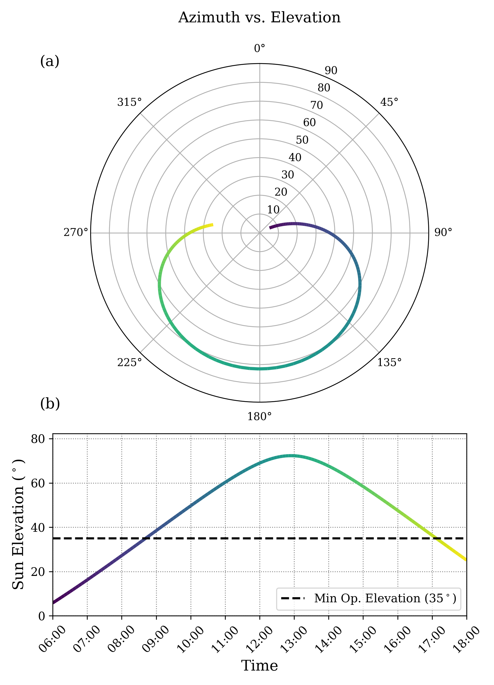
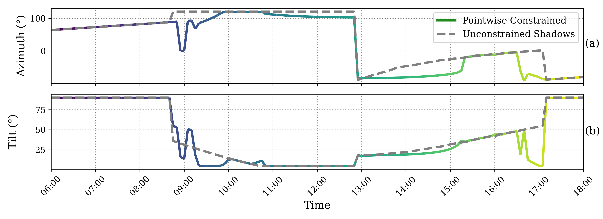
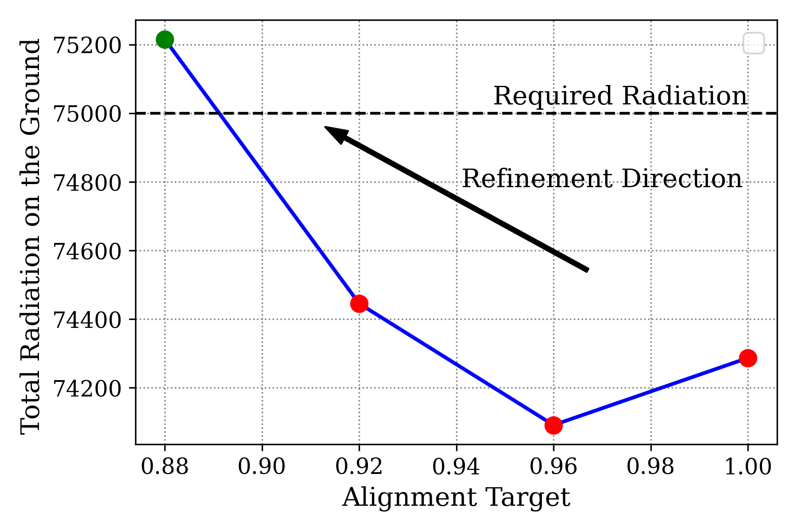
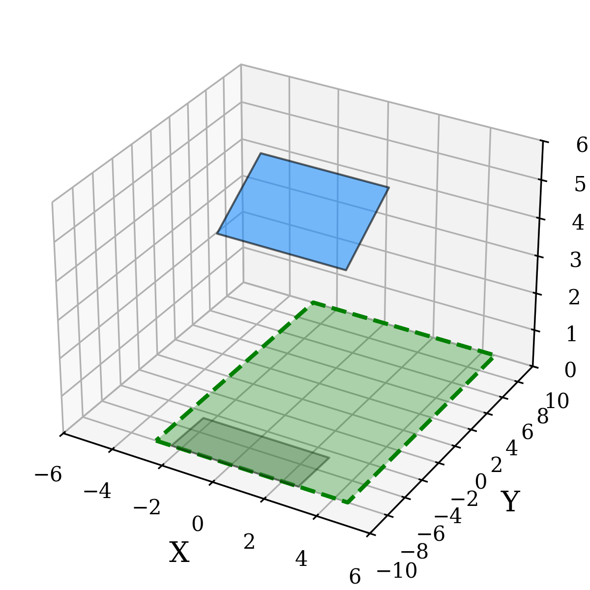
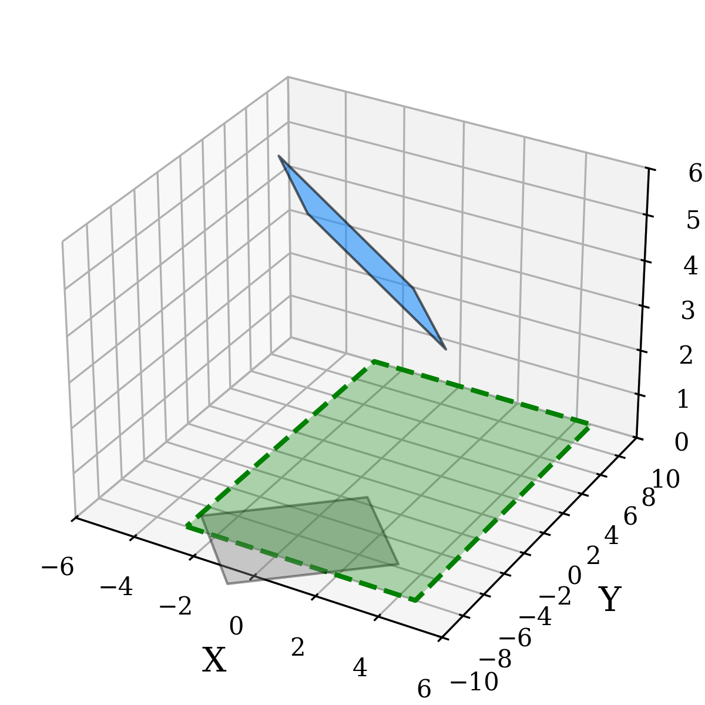
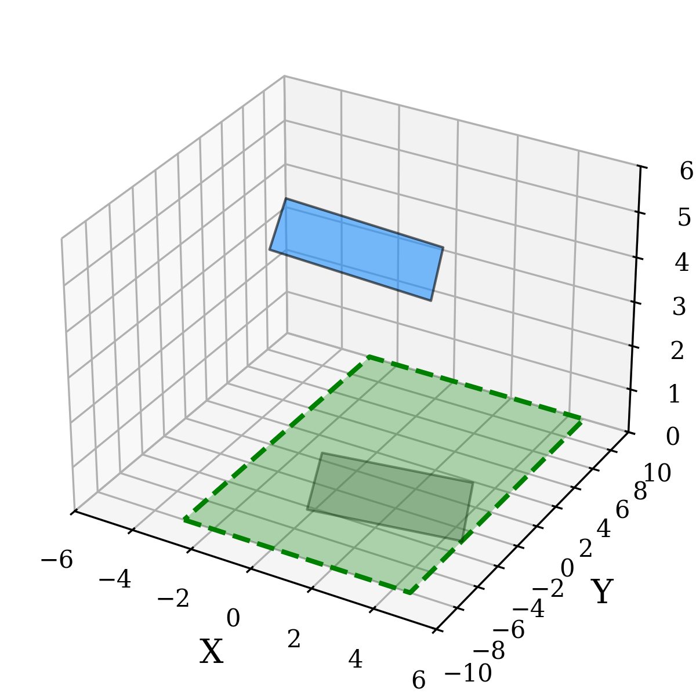

# Dynamic Agrivoltaic System: Solar Panel Orientation and Shadow-Constrained Optimization

A Python simulation of **dynamic agrivoltaic (agrovoltaic) panel orientation**, exploring the trade-off between aligning a photovoltaic (PV) panel with the sun and allowing sufficient sunlight to reach the ground beneath it.

The repository compares **shadow-constrained** and **unconstrained** panel-angle optimization, estimates a ground-radiation proxy, and generates plots and 3D visualizations of panel orientation and shadow projection.



## Overview

Agrivoltaic systems combine solar electricity generation with agricultural land use. For movable PV panels, the orientation that best aligns the panel with incoming sunlight may not be the orientation that provides the desired illumination at ground level.

This project implements a geometric and numerical model that:

1. Computes the sun's azimuth and apparent elevation throughout a selected day using `pvlib`.
2. Represents a rotating PV panel in 3D and projects its shadow onto the ground.
3. Optimizes panel azimuth and tilt to approach a chosen solar-alignment target.
4. Optionally enforces a geometric constraint on where the panel's projected shadow may fall.
5. Iteratively adjusts the alignment target until an aggregate ground-radiation threshold is met.
6. Compares constrained and unconstrained cases through figures and animations.

The implementation is intended for **simulation and method exploration**, not as a validated crop-growth, PV power-output, or field-control model.

## Method

The model uses a panel-normal vector and a sun-direction vector to measure **solar alignment** through their dot product. A goal-seeking objective adjusts the panel's azimuth and tilt to approach a target alignment value between 0 and 1.

Numerical optimization is performed using SciPy's **SLSQP** algorithm with panel-angle bounds. In the constrained case, a geometric inequality requires the projected shadow corners to remain within a specified rectangular ground region. The code also applies a low-sun-elevation rule that places the panel in a vertical orientation below a configurable threshold.

For ground illumination, the current implementation estimates the unshaded ground fraction and multiplies it by modeled global horizontal irradiance (GHI). It sums these estimates over simulation time steps and compares the result with `required_radiation`. **This sum is a model-specific proxy, not a time-integrated irradiation value in Wh/m²:** the code does not multiply each sample by the time-step duration. The shadow/irradiance approximation does not resolve diffuse light, partial-shading effects, or crop-specific light requirements.

## Example configuration

The default configuration in `main.py` is:

| Parameter | Default value | Description |
| --- | --- | --- |
| Location | Bari, Italy (`41.1171° N`, `16.8719° E`) | Geographic coordinates used for solar-position calculations |
| Time zone | `Europe/Rome` | Local simulation time zone |
| Date | `2024-06-21` | Example summer day |
| Simulation period | `06:00–18:00` | Five-minute sampling interval, with below-horizon points filtered out |
| Panel dimensions | `5 m × 5 m` | Width and length |
| Panel height | `5 m` | Height in the geometric model |
| Minimum sun altitude | `35°` | Below this threshold, the panel is set vertical |
| Alignment decrement | `0.02` | Reduction used in iterative target refinement |
| Ground-radiation threshold | `84000` | Threshold in the code's accumulated radiation-proxy units |

The optimization also uses a configurable rectangular ground region (`plant_bounds`), panel azimuth bounds of ±120°, and tilt bounds of 5°–90°.

## Installation

**Requirements:** Python 3 and the following packages: `numpy`, `pandas`, `scipy`, `matplotlib`, and `pvlib`.

```bash
git clone https://github.com/SabaAskariNoghani/Dynamic_Agrovoltaic.git
cd Dynamic_Agrovoltaic

python -m venv .venv
source .venv/bin/activate  # On Windows: .venv\Scripts\activate

python -m pip install numpy pandas scipy matplotlib pvlib
```

Package versions are not pinned in the repository; compatibility may depend on your Python environment.

## Usage

Open `main.py` and choose one of the two execution modes:

**Option A — View the included simulation results (default):**

```python
run_optimization_mode = False
```

This loads the repository's existing `visualization_data.pkl` file and generates the plots and animations without re-running optimization.

**Option B — Re-run the optimization:**

```python
run_optimization_mode = True
```

This computes both constrained and unconstrained solutions, writes a new `visualization_data.pkl`, and generates the visualizations. To change the example scenario, edit the location, date, geometry, ground bounds, or radiation threshold in `main.py` before running.

Run either mode from the repository's root directory:

```bash
python main.py
```

**Note:** The script opens Matplotlib windows for plots and 3D animations, so an interactive graphical environment is recommended. Python pickle files can execute arbitrary code when loaded: only open `visualization_data.pkl` if you trust its source.

## Visual outputs

The repository contains example figure files generated by the simulation.

### Solar position throughout the day


`figure1_combined_vertical.png` — Solar path and apparent elevation, including the minimum operating elevation threshold.

### Panel-angle comparison



`figure2_panel_angles_over_time.png` — Panel azimuth and tilt over time, comparing the constrained and unconstrained solutions.

### Ground radiation versus alignment target



`figure3_radiation_vs_alignment.png` — Iterative alignment-target refinement and the model's ground-radiation threshold.

### Example shadow projections

| Shadow-constrained | Unconstrained |
| --- | --- |
|  |  |
|  |  |

The program also displays 3D Matplotlib animations of panel motion and shadow projection for both cases.

## Repository structure

```text
Dynamic_Agrovoltaic/
├── main.py                          # Simulation setup, optimization workflow, visualization
├── utilities.py                     # Geometry, numerical optimization, figures, animation
├── visualization_data.pkl           # Saved example results used by default
├── figure1_combined_vertical.png
├── figure2_panel_angles_over_time.png
├── figure3_radiation_vs_alignment.png
├── figure4a_0900.png
├── figure4a_1200.png
├── figure4b_0900.png
└── figure4b_1200.png
```

## Limitations and further development

- The example uses a clear-sky GHI estimate from `pvlib` (`simplified_solis`), not measured irradiance.
- Ground illumination is approximated from shadow geometry and an unshaded-area fraction; no crop physiology or agricultural yield model is included.
- The aggregate radiation threshold depends on the simulation sampling interval and is **not** a calibrated agronomic dose or energy quantity.
- The optimization is a geometric, pointwise simulation; actuator dynamics, weather uncertainty, and real-world control constraints are not included.
- Results have not been independently verified here against measurements or a reference implementation.

## Author and citation

**Saba Askari Noghani**  
GitHub: [@SabaAskariNoghani](https://github.com/SabaAskariNoghani)

If you use this project in research, please credit the author and link to this repository:

[https://github.com/SabaAskariNoghani/Dynamic_Agrovoltaic](https://github.com/SabaAskariNoghani/Dynamic_Agrovoltaic)
This article Published in: 2025 IEEE International Conference on Systems, Man, and Cybernetics (SMC) with DOI 10.1109/SMC58881.2025.11343485

No `LICENSE` file was visible in the repository when this README was prepared; public access to source code does not by itself grant a license to reuse or redistribute it.
